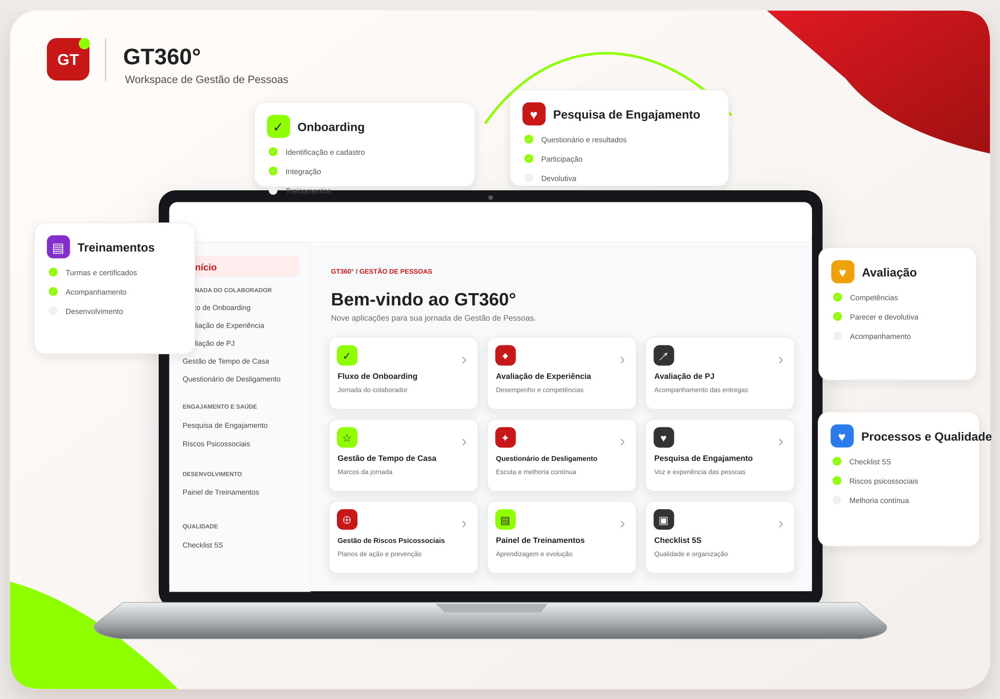

# Manoel Gustavo — Recursos Humanos, Desenvolvimento Organizacional e Inovação

> Recursos Humanos · Pessoas · Processos · Projetos · Dados

Atuo em operações de RH, desenvolvimento de pessoas, comunicação interna e melhoria de processos. Conecto essas experiências à identificação de necessidades, ao mapeamento e à ideação de soluções, com visão de Product Owner e estratégias de Scrum Master.

Nos projetos de sistemas, trabalho em parceria com Tecnologia: alinhamos requisitos e prioridades, acompanhamos o desenvolvimento, homologamos, validamos e colocamos as soluções em operação em conjunto.

[▶ Conhecer meu portfólio profissional](https://gustavomrtns.github.io/projetos_rh/) · [LinkedIn](https://www.linkedin.com/in/manoel-gustavo/)

## Minha atuação

- **Operações de RH:** recrutamento e seleção, Departamento Pessoal, benefícios e organização de rotinas.
- **Desenvolvimento organizacional:** integração, treinamentos, desempenho, competências e apoio às lideranças.
- **Dados e escuta:** pesquisas organizacionais, indicadores, painéis e relatórios.
- **Comunicação e design:** identidades visuais, campanhas, endomarketing e experiência do colaborador.
- **Projetos e soluções digitais:** necessidades, processos, ideação, priorização, facilitação e trabalho conjunto com Tecnologia.

Os cargos e períodos profissionais, a formação acadêmica, as capacitações e os cursos que ministrei estão apresentados no [portfólio](https://gustavomrtns.github.io/projetos_rh/).

## Projetos em contexto

Os [relatos de atuação](https://gustavomrtns.github.io/projetos_rh/#relatos) explicam o contexto, minha participação, a construção conjunta e as entregas de pesquisa de engajamento, onboarding, treinamentos e comunicação interna. Não reproduzem documentos, telas, dados individuais ou indicadores internos.

## Soluções digitais de RH

| Projeto | Proposta | Versão pública | Documentação |
|---|---|---|---|
| **GT360°** | Ambiente de Gestão de Pessoas com nove aplicações de jornada do colaborador, engajamento, desenvolvimento e qualidade. | [Explorar GT360°](https://gustavomrtns.github.io/projetos_rh/gt360/) | [Conhecer o projeto](./gt360/README.md) |
| **eu + horizonte** | Intranet idealizada para integrar colaboradores e apoiar comunicação, desenvolvimento, valorização e retenção de talentos. | [Explorar eu + horizonte](https://gustavomrtns.github.io/projetos_rh/eu-horizonte-intranet/) | [Conhecer o projeto](./eu-horizonte-intranet/README.md) |

### Implantação interna e apresentação pública

O sistema e os módulos internos do GT360° foram construídos e implantados em parceria entre RH e Tecnologia. Minha contribuição está na identificação de necessidades, no mapeamento, na ideação e priorização, nos alinhamentos e na homologação, validação e implantação conjunta.

Este repositório apresenta **adaptações públicas com dados fictícios**, e não o código, os documentos ou a infraestrutura dos ambientes corporativos. As informações técnicas abaixo descrevem somente as demonstrações disponíveis neste endereço.

### GT360° — módulos do workspace

| Frente | Aplicações |
|---|---|
| Jornada do Colaborador | Fluxo de Onboarding; Avaliação de Experiência CLT; Avaliação de PJ; Gestão de Tempo de Casa; Questionário de Desligamento |
| Engajamento e Saúde Organizacional | Pesquisa de Engajamento; Gestão de Riscos Psicossociais |
| Desenvolvimento de Talentos | Painel de Treinamentos |
| Qualidade e Processos | Checklist 5S |

## Dados e funcionamento das versões públicas

As aplicações públicas usam **estado temporário em memória (`demoStore`)**. No GT360°, os módulos compartilham esse estado enquanto o workspace está aberto. Ao atualizar ou fechar a página, os registros temporários são descartados.

As demonstrações não possuem conta, banco de dados compartilhado, sincronização entre pessoas ou dispositivos nem backup/restauração. Exportações específicas, quando oferecidas, não equivalem a backup do ambiente.

**Use apenas dados fictícios. Não cadastre informações pessoais reais.** Essas limitações pertencem às adaptações públicas e não descrevem a infraestrutura dos sistemas internos.

[Contato pelo LinkedIn](https://www.linkedin.com/in/manoel-gustavo/) · [Voltar ao portfólio](https://gustavomrtns.github.io/projetos_rh/)
