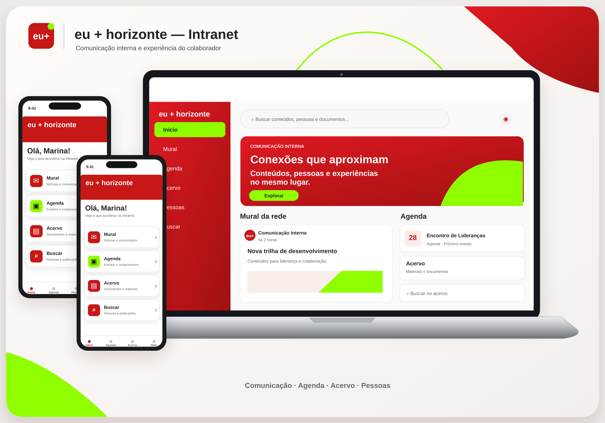

# eu + horizonte — Comunicação Interna e Experiência do Colaborador

> Uma proposta de intranet para integrar pessoas, conteúdos e cultura.

[▶ Explorar a versão pública](https://gustavomrtns.github.io/projetos_rh/eu-horizonte-intranet/) · [Portfólio profissional](https://gustavomrtns.github.io/projetos_rh/#eu-horizonte) · [Visão geral](../README.md)

## Necessidade e propósito

Quando comunicados, agendas e documentos ficam distribuídos em vários canais, encontrar informações exige mais esforço e a experiência interna perde consistência.

O **eu + horizonte** foi idealizado como apoio organizacional ao desenvolvimento, à valorização e à retenção de talentos, com o propósito de integrar colaboradores e gerar valor à experiência interna.

## Minha participação

- Identificação de necessidades de comunicação e experiência do colaborador.
- Ideação do projeto e definição da proposta de valor para o público interno.
- Organização de conteúdos, arquitetura de informação e jornadas de navegação.
- Concepção da identidade visual e da experiência de uso.
- Priorização e validação funcional da proposta, com visão de Product Owner e práticas de facilitação ágil.

Minha abordagem em projetos de sistemas conecta necessidades e mapeamento à ideação e aos alinhamentos com Tecnologia para desenvolvimento, homologação, validação e implantação conjunta. A apresentação pública evidencia o conceito, a navegação e os fluxos do eu + horizonte, sem divulgar código, documentos ou infraestrutura corporativa.

## O que a versão pública apresenta

| Frente | Proposta |
|---|---|
| **Mural e ativações** | Organizar comunicados, campanhas e conteúdos internos. |
| **Agenda** | Facilitar o acompanhamento de eventos e programações. |
| **Acervo** | Reunir documentos e materiais em uma navegação organizada. |
| **Publicação** | Estruturar a criação e o compartilhamento de conteúdos. |
| **Pessoas** | Aproximar os pontos de contato da experiência interna. |

*Composição de apresentação da proposta pública, sem materiais internos.*

## Comunicação, design e desenvolvimento organizacional

A proposta conecta criação de identidade visual, comunicação interna, endomarketing e experiência do colaborador. O valor pretendido está em facilitar o acesso à informação e a conexão com as iniciativas da organização.

Os [relatos profissionais](https://gustavomrtns.github.io/projetos_rh/#relatos) explicam a atuação em comunicação e design sem reproduzir peças internas ou afirmar ganhos de retenção não mensurados.

## Dados da demonstração

A versão pública utiliza HTML, CSS e JavaScript e as pessoas fictícias de `shared/demo-core.js`. Publicações e interações ficam somente em **memória (`demoStore`)** e são reiniciadas quando a página é recarregada.

Não há conta, persistência durável, sincronização entre usuários ou backup/restauração. As características técnicas deste repositório descrevem a apresentação pública, e não a infraestrutura de ambientes internos.

**Use somente dados fictícios. Não cadastre informações pessoais reais.**

## Como continuar a visita

Use **Voltar ao portfólio**, no cabeçalho da intranet, para retornar às experiências e aos demais projetos.

[▶ Abrir eu + horizonte](https://gustavomrtns.github.io/projetos_rh/eu-horizonte-intranet/) · [Voltar ao portfólio](https://gustavomrtns.github.io/projetos_rh/#projetos)
