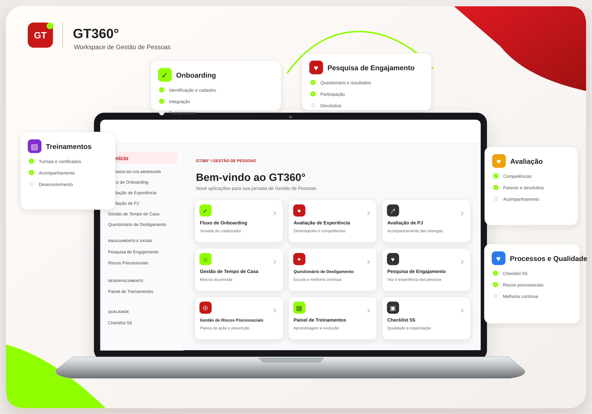

# GT360° — Workspace de Gestão de Pessoas

> Rotinas de RH organizadas a partir das necessidades das pessoas e dos processos.

[▶ Explorar a versão pública](https://gustavomrtns.github.io/projetos_rh/gt360/) · [Portfólio profissional](https://gustavomrtns.github.io/projetos_rh/#solucoes-digitais) · [Visão geral](../README.md)

## Contexto profissional

A rotina de RH envolve integração, avaliações, escuta, desenvolvimento e acompanhamento de processos. Informações e controles dispersos dificultam a visão da jornada e a organização das demandas.

O GT360° nasceu dessas necessidades e evoluiu como um ambiente de Gestão de Pessoas. **O sistema e os módulos internos foram desenvolvidos e implantados em parceria entre RH e Tecnologia.** A versão deste repositório adapta esse trabalho para apresentação pública, com nove aplicações navegáveis e dados fictícios.

## Minha participação e construção conjunta

| Etapa | Contribuição |
|---|---|
| **Identificar e mapear** | Compreender necessidades, ouvir as áreas envolvidas e organizar processos e jornadas de RH. |
| **Idear e priorizar** | Estruturar a proposta, o escopo, os requisitos, as regras de negócio e as prioridades, com visão de Product Owner. |
| **Alinhar e acompanhar** | Facilitar conversas com stakeholders e Tecnologia, organizar entregas e apoiar a colaboração com estratégias de Scrum Master. |
| **Homologar e validar** | Participar de testes funcionais, registrar ajustes e validar a aderência das funcionalidades às rotinas de RH junto ao time de Tecnologia. |
| **Implantar e apoiar a adoção** | Colocar as soluções em operação em conjunto, orientar os usuários e acompanhar necessidades de evolução. |

O desenvolvimento técnico é apresentado como **trabalho conjunto com Tecnologia**. A participação descrita não deve ser confundida com a execução individual de toda a implementação técnica.

## Entregas apresentadas

- Fluxos para integração e acompanhamento da jornada do colaborador.
- Pesquisa de engajamento e organização da leitura de resultados.
- Gestão de treinamentos e acompanhamento de processos.
- Navegação que reúne nove aplicações em um único ambiente público.

Os [relatos de atuação](https://gustavomrtns.github.io/projetos_rh/#relatos) contextualizam pesquisa, onboarding e treinamentos sem expor materiais internos nem atribuir resultados quantitativos não divulgados.

## Módulos

| Frente | Aplicação | O que a pessoa pode explorar |
|---|---|---|
| Jornada do Colaborador | [Fluxo de Onboarding](https://gustavomrtns.github.io/projetos_rh/gt360/?modulo=onboarding) | Registro e acompanhamento da integração. |
| Jornada do Colaborador | [Avaliação de Experiência](https://gustavomrtns.github.io/projetos_rh/gt360/?modulo=avaliacao-clt) | Avaliação e parecer do período de experiência. |
| Jornada do Colaborador | [Avaliação de PJ](https://gustavomrtns.github.io/projetos_rh/gt360/?modulo=avaliacao-pj) | Acompanhamento e avaliação de prestadores. |
| Jornada do Colaborador | [Gestão de Tempo de Casa](https://gustavomrtns.github.io/projetos_rh/gt360/?modulo=tempo-casa) | Marcos da jornada e celebrações. |
| Jornada do Colaborador | [Questionário de Desligamento](https://gustavomrtns.github.io/projetos_rh/gt360/?modulo=desligamento) | Coleta e organização de devolutivas de saída. |
| Engajamento e Saúde Organizacional | [Pesquisa de Engajamento](https://gustavomrtns.github.io/projetos_rh/gt360/?modulo=engajamento) | Aplicação de pesquisa e leitura dos resultados de engajamento. |
| Engajamento e Saúde Organizacional | [Gestão de Riscos Psicossociais](https://gustavomrtns.github.io/projetos_rh/gt360/?modulo=riscos-psicossociais) | Organização de avaliações e planos de ação. |
| Desenvolvimento de Talentos | [Painel de Treinamentos](https://gustavomrtns.github.io/projetos_rh/gt360/?modulo=treinamentos) | Treinamentos, turmas, certificações e indicadores. |
| Qualidade e Processos | [Checklist 5S](https://gustavomrtns.github.io/projetos_rh/gt360/?modulo=checklist-5s) | Auditorias e acompanhamento da conformidade. |

> **Distinção conceitual:** a Pesquisa de Engajamento Organizacional é apresentada como pesquisa de engajamento, não como pesquisa de clima organizacional.

## Percurso para explorar a versão pública

1. Abra a [página inicial](https://gustavomrtns.github.io/projetos_rh/gt360/) para conhecer a organização dos módulos.
2. Explore o [Onboarding](https://gustavomrtns.github.io/projetos_rh/gt360/?modulo=onboarding).
3. Conheça a [Pesquisa de Engajamento](https://gustavomrtns.github.io/projetos_rh/gt360/?modulo=engajamento) e o [Painel de Treinamentos](https://gustavomrtns.github.io/projetos_rh/gt360/?modulo=treinamentos).
4. Use o link **Voltar ao portfólio**, no cabeçalho, para continuar a visita.

*Imagem de apresentação da adaptação pública. Não reproduz telas ou dados internos.*

## Limites da demonstração

A descrição técnica a seguir se refere **exclusivamente à adaptação pública**, feita em HTML, CSS e JavaScript. Não documenta a arquitetura, as permissões, o banco de dados ou a infraestrutura da implantação interna.

### Funcionamento e dados da versão pública

Esta versão demonstra as interfaces e fluxos das aplicações. A integração **atual é de navegação**, com uma base fictícia compartilhada entre os módulos por `shared/demo-core.js`, e não um banco de dados central. Cada módulo é carregado em um arquivo HTML próprio quando aberto. O `demoStore` mantém as alterações **somente na memória da sessão da página**: os módulos acessam esse estado enquanto o workspace está aberto, mas atualizar ou fechar a página reinicia os dados de demonstração. Não há sincronização entre pessoas, dispositivos ou abas independentes. **Não cadastre informações pessoais reais no endereço público.**

**Backup e restauração:** o workspace atual **não possui** os botões "Baixar backup" e "Restaurar backup". Esses recursos foram retirados da demonstração; os registros temporários não são enviados ao servidor nem preservados entre recarregamentos. Exportações e relatórios específicos de alguns módulos, quando oferecidos, são funcionalidades distintas e não representam backup completo do workspace.

Uma eventual evolução desta demonstração para um novo ambiente multiusuário exigiria planejar autenticação, permissões, banco de dados e auditoria, além de testes de experiência e acessibilidade. Isso não descreve a infraestrutura corporativa já existente.

[▶ Abrir GT360°](https://gustavomrtns.github.io/projetos_rh/gt360/) · [Voltar ao portfólio](https://gustavomrtns.github.io/projetos_rh/#projetos)
